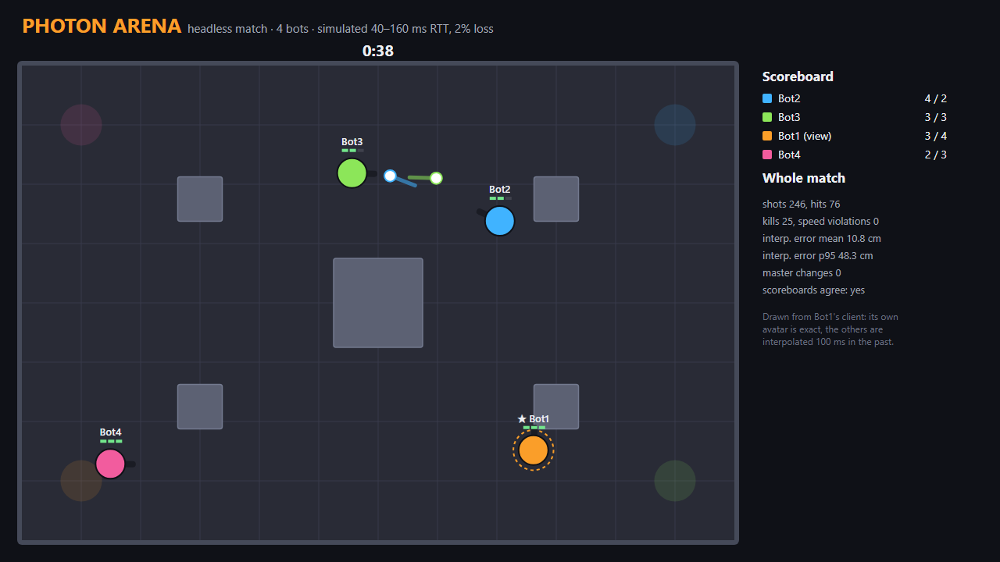
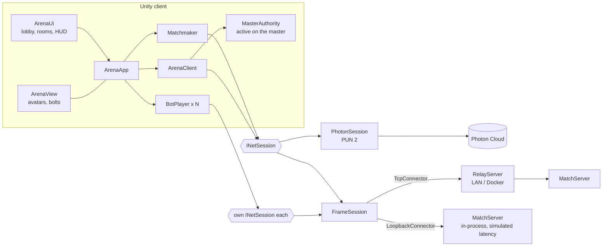
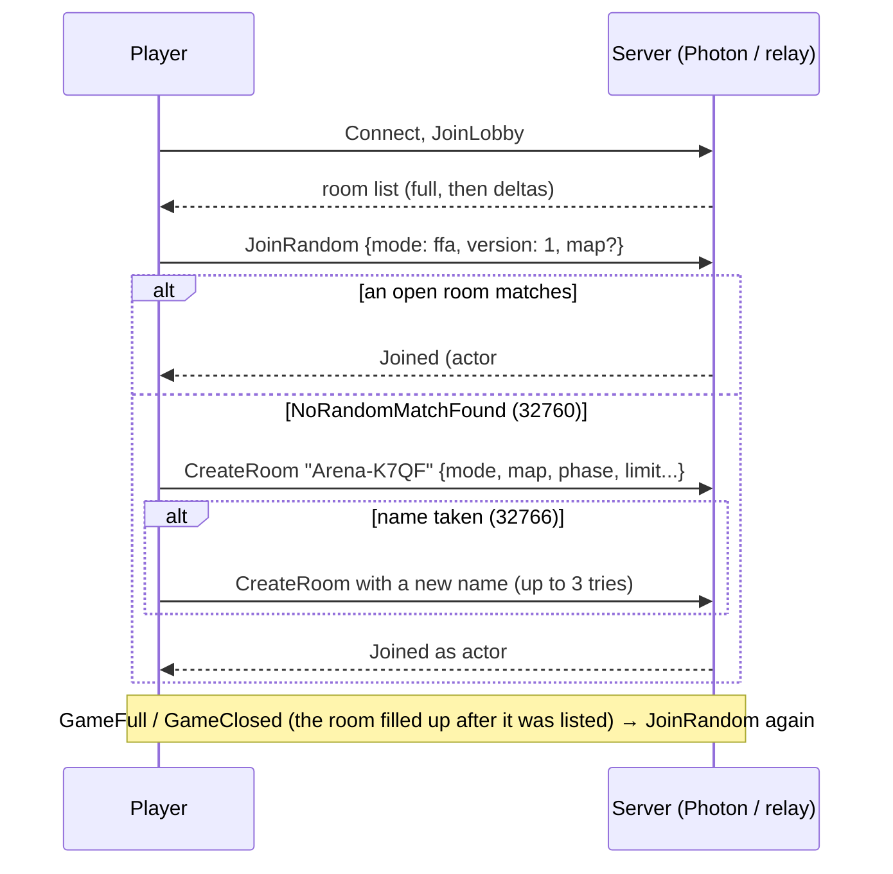

# Photon Arena

A small 2–4 player top-down arena shooter for Unity 6, built on **Photon PUN 2**, with a lobby, a room browser and quick-match matchmaking.

Most Photon tutorials stop at "two cubes move in the same room". A game people can actually play needs more. Players have to find each other through mode and map filters, and quick match has to cope with two players creating rooms at once or a listed room filling up before you join. The match itself (ready check, countdown, scoring, respawns) needs one fair referee, and play has to continue when that referee's connection drops. Shots have to feel instant without letting a laggy player hit someone who has already moved behind a wall. This project builds all of that on top of a small networking interface shaped like PUN. The game logic is plain C# with no Unity dependency, so it's tested headlessly: real server, real sessions, simulated latency and packet loss.



*This picture comes from the headless simulator (`arena simulate --svg`). It shows a real match frame, drawn from one bot's client, with the run's measured netcode numbers. It is **not** a screenshot of the Unity client. See [Limitations](#limitations) for why there isn't one yet.*

## What's in it

- **Three backends behind one interface.** `INetSession` is modeled on PUN 2: master server, lobby, rooms, actor numbers, master client, custom properties with compare-and-swap, `RaiseEvent`, a shared server clock.
  - **Photon Cloud:** a thin PUN 2 adapter.
  - **LAN relay:** a TCP room server, hosted in-game or as a dedicated process or container.
  - **Offline:** the same server in-process, with simulated latency, plus bots.
- **Lobby and matchmaking.** A live room list (incremental updates, with rooms that fill up or close removed from the list) and join by name. Quick match filters on mode, map and game version, creates a room when nothing matches, and retries when a listed room fills up in the meantime or a generated name is already taken.
- **Master-client authority.** The master client runs the phase machine (waiting → countdown → playing → results), hit detection, damage, respawns and scoring. Every decision is stored in room and player properties on the server, so when the master leaves, the next master continues from them. A ready check starts the countdown, the room closes during a match and reopens afterwards.
- **Netcode.**
  - Each player moves their own avatar, which feels instant, and sends 18-byte state updates at 20 Hz.
  - Remote players are interpolated 100 ms in the past, with up to 150 ms of extrapolation when updates stop.
  - Bolts are deterministic. A shot is just (origin, angle, server time), so every client flies the same bolt and nothing is streamed per frame.
  - **Lag compensation:** the master checks a shot against where targets were *when it was fired*, rewinding at most 250 ms.
  - **Cheat checks:** shots from where the shooter wasn't, faster than the fire cooldown, or from the future are rejected. Movement faster than possible is clamped and counted.
- **Bots** are full network clients with a simple brain: approach, strafe, lead the target, get unstuck from walls. They play through the same netcode as humans, can become master, and let one person test a 4-player match.
- **Headless tools** (`arena` CLI): a dedicated relay, bots that join a relay, and a match simulator that reports interpolation error, hit rates and scoreboard consistency.

## How it works



Everything left of `INetSession` is engine-free C# in [Assets/PhotonArena/Core](Assets/PhotonArena/Core). The asmdef has `noEngineReferences`, so it can't touch UnityEngine by accident. The Unity layer ([Runtime](Assets/PhotonArena/Runtime)) only reads input, renders an `ArenaFrame` and builds the UI.

### Quick match



### Who decides what

| State | Owner | Carried by |
| --- | --- | --- |
| Own position, aim | each player | `State` event, unreliable, 20 Hz, to Others |
| A shot | the shooter | `Fire` event, reliable; the shooter spawns its bolt immediately |
| Hit, damage, kill | master client | player props (`hp`, `al`, `k`, `d`) + `Hit` event for effects |
| Respawn | master client | player props (`sp` spawn index, `lf` life counter → owner teleports) |
| Phase, timers, winner | master client | room props, written with compare-and-swap on `ph` + `rn` |
| Ready | each player | own player prop `rdy` |
| Colors | master client | player prop `col`, written only if absent (CAS) |

Property writes are applied when the server echoes them to everyone (Photon's `BroadcastPropsChangeToAll`), so all clients see changes in the same order. Room and player properties live on the server, so a master hand-over only loses bolts that were in flight.

### Measured on the simulator

`arena simulate` runs a full match with bots over the real server and sessions. Only time and the wire are simulated, and a given seed always gives the same match. The server clock starts 20 s before the int32 wrap on purpose. Results from the current code:

| Run | One-way latency | Loss | Hit rate | Interpolation error (mean / p95) | Scoreboards agree |
| --- | --- | --- | --- | --- | --- |
| 4 bots, Pillars | 20 / 40 / 60 / 80 ms ± 10 | 2% | 30.9% | 10.8 cm / 48.3 cm | yes |
| same, master drops out 15 s in | same | 2% | 32.6% | 11.1 cm / 49.3 cm | yes |
| Duel, Crossfire | 30 / 60 ms ± 10 | 5% | 37.3% | 8.1 cm / 39.0 cm | yes |

"Interpolation error" is the distance between where an observer draws a remote avatar and where that avatar really was at the time being shown, measured from every client for every other player. Speed-check violations were 0 in every run, so honest clients never trip it.

The simulator also caught a real bug during development. A client that became master after the server clock wrapped treated "protected until time 0" as protection for about 24 days, and the hit rate fell to 12%. The match-flow tests now run three times: with the clock near zero, wrapping mid-test, and negative.

## Tech stack

- Unity 6 (6000.2), C# 9, built-in render pipeline, uGUI built from code (legacy `Text`, no TextMeshPro import), legacy Input Manager
- Photon PUN 2 (Asset Store), optional, compiled only when installed
- .NET 9 SDK for the headless core build, tests and CLI; the core targets netstandard2.1 like Unity
- NUnit 3: one test suite that runs in both Unity's Test Runner and `dotnet test`
- Docker / Compose for the relay and headless bots

## Run it

### In Unity (Offline mode, no account needed)

1. Open the folder with **Unity 6000.2.6f2** (any 6000.2.x should do) through Unity Hub.
2. On first open, an editor script generates `Assets/PhotonArena/Scenes/Arena.unity` and two template materials. You can also run **Photon Arena → Rebuild Scene**. Pressing Play in any scene works too, because `ArenaApp` creates itself if it's missing.
3. Press **Play**. Pick **Offline + bots**, choose a simulated ping, click **Connect**, then **Quick match**. In the room, click **+ Bot** up to three times and **Ready**.

| Key | Action |
| --- | --- |
| WASD / arrows | Move |
| Mouse | Aim |
| Left click / Space | Fire |

Hits take one of three HP pips, the killer scores, and the victim respawns after 2 s at the spawn point farthest from enemies. First to 10 kills (5 in a duel) or most kills after 2 minutes wins. Ties on kills go to fewer deaths, and a full tie is a draw.

### LAN

Either player can host. Pick **LAN relay**, click **Host here**, then **Connect**. Others pick **LAN relay**, type the host's IP and connect (TCP 7777). Bots work on LAN too.

A dedicated relay with two bots already waiting in a room:

```bash
docker compose up          # relay on :7777 + 2 bots waiting in an open FFA room
# or without Docker:
dotnet run --project dotnet/PhotonArena.Cli -- relay
dotnet run --project dotnet/PhotonArena.Cli -- bots --count 2
```

### Photon Cloud

1. Import **PUN 2 - FREE** from the Asset Store (Package Manager → My Assets). That defines `PHOTON_UNITY_NETWORKING`, which switches on [Assets/PhotonArena/Photon](Assets/PhotonArena/Photon). Until then, choosing Photon in the lobby shows what's missing, and Connect stays disabled.
2. Create a *PUN* app at [dashboard.photonengine.com](https://dashboard.photonengine.com) and put its App ID in `.env`. That way the ID never has to be committed into `PhotonServerSettings`:
   ```bash
   cp .env.example .env    # PHOTON_APP_ID=..., optionally PHOTON_REGION=eu
   ```
   The PUN Wizard's own App ID field works as well. Set `PHOTON_REGION` when testing with friends: by default PUN picks the best region per player, and players in different regions never see each other's rooms.
3. Pick **Photon Cloud** → Connect → Quick match. Bots are off on Photon, because `PhotonNetwork` is one connection per process. Use a second build, or the Offline/LAN backends, for multi-client tests.

### Building a player and the scripted demo

```powershell
./scripts/unity.ps1 build         # Builds/Windows/PhotonArena.exe
./scripts/unity.ps1 screenshot    # plays an offline match with 3 bots, saves docs/screenshot.png
```

The player accepts `-arenaAutoplay -arenaBots 3 -arenaScreenshot path.png -arenaScreenshotAfter 25 -arenaQuit`, plus `-arenaBackend offline|lan -arenaLanHost IP -arenaNick NAME -arenaMap pillars|crossfire`.

## Tests

```bash
dotnet test dotnet/PhotonArena.sln        # 130 tests, about 10 s, no Unity or Photon needed
```

The tests live in [Assets/Tests/EditMode](Assets/Tests/EditMode). Unity's Test Runner runs the same files, through the asmdef in that folder.

- **Wire format:** round-trips, truncated, oversized and invalid-UTF-8 input, quantization, angle wrap.
- **Server:** lobby full list and deltas, removal of full, closed and empty rooms, create, join and join-random errors with Photon's error codes, FillRoom ordering, filters limited to lobby-visible properties, actor numbering, master hand-over, compare-and-swap, event routing, unreliable loss, hello timeout, malformed frames, protocol version.
- **Matchmaker:** quick match creating, then filling, then overflowing rooms, never mixing modes, name-collision retry, back to the lobby after leaving.
- **Simulation:** collision and sliding, projectile casts, line of sight, snapshot interpolation and extrapolation across the clock wrap.
- **Match flow** (×3 clock bases):
  - Ready, countdown and cancel.
  - Spawns at match start.
  - A real shot across a 40 ms network.
  - Lag compensation: a late shot within the 250 ms cap hits, an older one can't.
  - Rejection of shots from the wrong origin, too fast, or from the future; speed-hack clamping.
  - Kill and respawn, score limit and timeout endings, the room reopening.
  - Master leaving mid-match, forged hit events, garbage events.
- **Headless matches:** four bots over a lossy network, determinism, the master dropping out, a duel.
- **Relay over real TCP:** two clients meeting, a dropped connection, refused connects, oversized frames, bots playing over sockets.

There are two more checks for the Unity side:

```bash
# Type-check Runtime, Editor, PlayMode tests and the Photon adapter against the editor's own assemblies:
dotnet build dotnet/PhotonArena.UnityCheck -p:UnityScriptAssemblies=<a Unity project>/Library/ScriptAssemblies
# In Unity (close the editor first):
./scripts/unity.ps1 test         # EditMode (the suite above) + PlayMode (loads the scene, plays offline with bots)
```

## Headless CLI

```text
arena relay    [--port 7777]
arena bots     [--host 127.0.0.1] [--port 7777] [--count 3] [--room NAME] [--mode ffa|duel] [--ready-alone]
arena simulate [--players 4] [--mode ffa|duel] [--map pillars|crossfire] [--duration 60]
               [--latency 40] [--jitter 10] [--loss 0.02] [--seed 7] [--drop-master SECONDS] [--svg FILE]
```

Headless bots stay un-ready until a human is in their room, so they hold an open room instead of starting (and closing) a match among themselves. `--ready-alone` lets them play each other.

## Project layout

```
Assets/PhotonArena/
  Core/            engine-free (noEngineReferences)
    Net/           INetSession, PropertyBag, models; Wire/ binary protocol; Transport/ loopback + TCP links;
                   Server/ MatchServer + RelayServer; Client/ FrameSession + ClockSync
    Matchmaking/   Matchmaker, RoomListCache, RoomKeys, room names
    Match/         ArenaClient, MasterAuthority, SnapshotBuffer, Bolt, GameMessages
    Sim/           Vec2, ArenaMap (+ maps), ArenaRules
    Bots/          BotBrain, BotPlayer, HeadlessMatch
  Runtime/         ArenaApp, NetBackends, UI/ (UiKit, ArenaUi), View/ (ArenaView, AvatarRenderer), Gameplay/ input
  Photon/          PhotonSession + PhotonConfig (only compiled with PUN 2 installed)
  Editor/          SceneBuilder (also runs on first open), BuildScript
Assets/Tests/      EditMode (shared with dotnet), PlayMode
dotnet/            PhotonArena.Core / .Tests / .Cli projects, UnityCheck compile project, PunApiStandIn
scripts/unity.ps1  scene | test | build | screenshot
```

## Limitations

- **The Unity client has not been run yet.** The editor's license on the dev machine had expired, and batch mode stops at the license check before compiling anything. So:
  - The Runtime, Editor and PlayMode code has been type-checked against Unity 6000.2.6f2's real assemblies (`PhotonArena.UnityCheck`, zero warnings), but never executed.
  - The scene has never been generated, there is no player build, and there is no `docs/screenshot.png`.
  - The UI layout, camera framing and materials are untested by eye.
  - Everything they display is covered by the headless tests.
- **PUN 2 adapter: compiled, never connected.**
  - It was compiled only against [a stand-in for the PUN 2 API](dotnet/PhotonStubs/PunApiStandIn.cs), whose signatures were transcribed from PUN's documentation, because PUN can only be downloaded through the Asset Store.
  - It has never connected to Photon Cloud.
  - `RoomOptions.MaxPlayers` changed from `byte` to `int` in later PUN 2 versions. The adapter assigns a `byte` so it compiles against both.
- **Docker** files are written but untested (no Docker on the dev machine).
- **Movement is client-authoritative**, which is the usual PUN design. The master clamps impossible speeds for its own hit checks and counts them, but doesn't kick anyone, and other clients still draw what the cheater sends.
- **The LAN relay is TCP only.** A lost packet delays the ones behind it (head-of-line blocking). That's fine on a LAN, but over the internet use Photon (UDP) or add a UDP transport behind `IFrameLink`.
- **No reconnect or rejoin** (`PlayerTtl` is 0). A dropped player has to join again, after the match if it's in progress, because rooms close during a match.
- **Master hand-over drops in-flight shots.** Bolts the old master was still checking when it left can't hit anymore.
- **Interpolation delay is a fixed 100 ms.** With one-way latency plus jitter above about 50 ms the client extrapolates more often, which is why p95 error grows on the 80 ms link. An adaptive delay would fix that.
- **No WebGL:** the LAN backend uses raw TCP sockets. The Offline backend and Photon would work in WebGL; neither has been built for it.


## sort entries

Updated implementation details.
